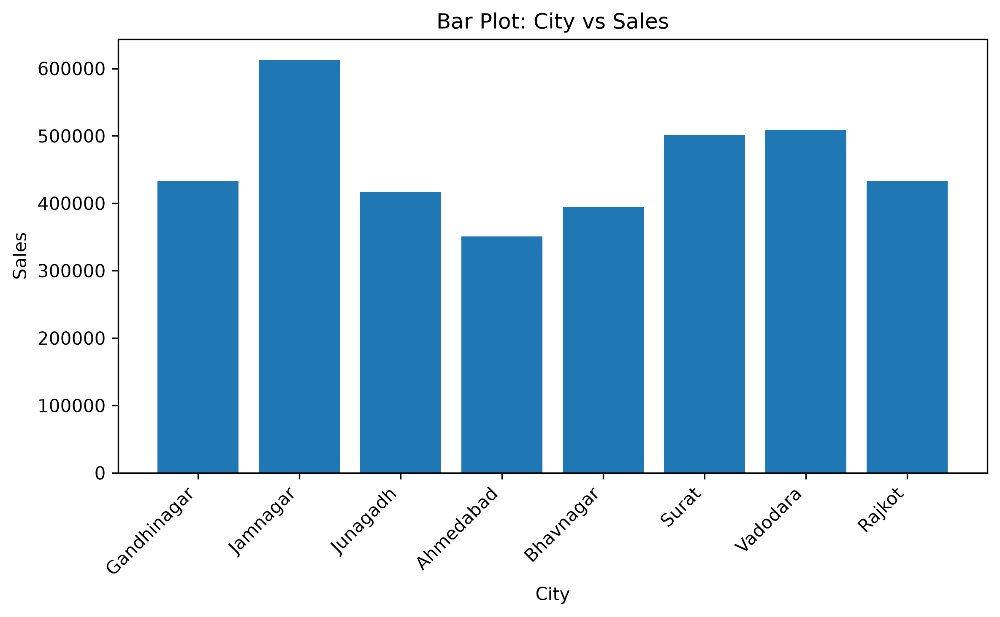
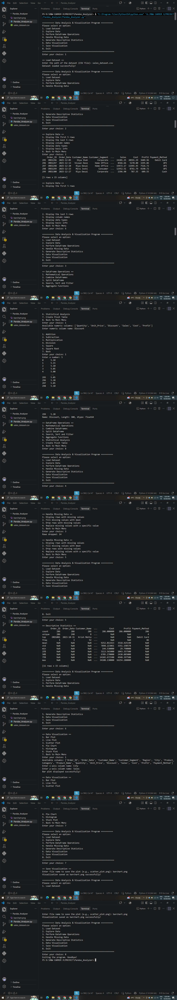

# 📊 Pandas Analyzer

**Author:** Meera Kyada

## 📌 Introduction

Pandas Analyzer is a Python-based data analysis and visualization project developed to perform different operations on CSV datasets. It uses Pandas, NumPy, and Matplotlib libraries to explore, process, analyze, and visualize data.

The project provides a menu-driven interface that allows users to load datasets, explore rows and columns, perform mathematical operations, handle missing values, generate descriptive statistics, create pivot tables, and generate different types of graphs.

## 📖 Project Description

Pandas Analyzer is designed to make data analysis easier and more organized. It allows users to work with CSV files and perform various DataFrame operations through a simple command-line interface.

The program supports combining and splitting DataFrames, searching and filtering records, sorting data, performing aggregate calculations, and analyzing numerical columns. It also provides visualization options such as bar plots, line plots, scatter plots, pie charts, histograms, and stack plots.

Users can save the generated visualizations in different file formats for future use.

## 🎯 Project Objectives

- To understand the fundamentals of data analysis using Python.
- To learn how to load and process CSV datasets.
- To explore rows, columns, and data types.
- To perform mathematical and statistical operations.
- To handle missing values in datasets.
- To combine and split DataFrames.
- To search, sort, and filter records.
- To create pivot tables and descriptive statistics.
- To visualize data using different types of graphs.
- To save generated visualizations in different formats.

## ✨ Features

1. **Load Dataset:** Load a CSV dataset and check whether the file exists.
2. **Explore Data:** Display the first five rows, last five rows, column names, data types, and basic dataset information.
3. **Mathematical Operations:** Perform addition, subtraction, multiplication, division, square, and square root operations on numerical columns.
4. **Combine DataFrames:** Combine two CSV datasets using concatenation or merging.
5. **Split DataFrame:** Split a DataFrame according to the number of rows or values in a selected column.
6. **Search, Sort and Filter:** Search for specific values, sort records in ascending or descending order, and filter numerical data.
7. **Aggregate Functions:** Calculate sum, mean, minimum, maximum, count, median, standard deviation, and variance.
8. **Statistical Analysis:** Generate descriptive statistics, correlation matrices, variance, and skewness.
9. **Create Pivot Table:** Summarize data using selected index and value columns with different aggregation functions.
10. **Handle Missing Data:** Display, fill, drop, or replace missing values.
11. **Generate Statistics:** Generate descriptive statistics for dataset columns.
12. **Data Visualization:** Create bar plots, line plots, scatter plots, pie charts, histograms, and stack plots.
13. **Save Visualization:** Save graphs in PNG, JPG, JPEG, PDF, or SVG format.
14. **Menu-Driven Program:** Perform operations through a simple command-line menu.

## 🛠️ Technologies Used

| Technology | Description |
|---|---|
| Python | Main programming language |
| Python 3.14.6 | Python version |
| Visual Studio Code | Code editor |
| Pandas | Data manipulation and DataFrame operations |
| NumPy | Numerical calculations |
| Matplotlib | Data visualization |
| OS Module | File existence checking |
| CSV | Dataset file format |
| Git | Version control |
| GitHub | Code hosting platform |

## 📚 Libraries Used

### 1. Pandas

Pandas is a Python library used for data manipulation and analysis. It provides DataFrames and Series to organize and process structured data.

In this project, Pandas is used to:
- Read CSV files.
- Explore dataset information.
- Select and filter rows and columns.
- Sort and combine DataFrames.
- Handle missing values.
- Calculate descriptive statistics.
- Create pivot tables.

### 2. NumPy

NumPy is a Python library used for numerical computing. It provides mathematical functions and tools for working with numerical data.

In this project, NumPy is imported as `np` and used alongside Pandas for numerical operations.

### 3. Matplotlib

Matplotlib is a Python library used to create data visualizations.

In this project, Matplotlib is used to create different types of graphs and save the generated visualizations.

### 4. OS Module

The OS module provides functions for interacting with the operating system.

In this project, the `os.path.isfile()` function checks whether the specified dataset file exists before loading it.

## 🧠 Concepts Covered

- Python Fundamentals
- Object-Oriented Programming (OOP)
- Classes and Objects
- Constructors
- Instance Attributes
- User-Defined Methods
- Conditional Statements
- Loops
- Functions and Method Calls
- Exception Handling
- File Handling
- CSV File Processing
- Pandas DataFrames
- NumPy Numerical Operations
- Data Cleaning
- Missing Value Handling
- Data Manipulation
- Statistical Analysis
- Data Visualization
- Saving Files
- Main Module Execution using `__name__ == "__main__"`

## 🏗️ Object-Oriented Programming

The project uses Object-Oriented Programming to organize the data analysis operations into a class.

### Class: `SalesDataAnalyzer`

The `SalesDataAnalyzer` class manages the dataset and provides methods for exploring, processing, analyzing, and visualizing data.

### Attributes

| Attribute | Description |
|---|---|
| `self.data` | Stores the loaded dataset as a Pandas DataFrame |
| `self.current_figure` | Stores the current Matplotlib figure for saving |

### Important Methods

| Method | Description |
|---|---|
| `__init__()` | Initializes the dataset and visualization attributes |
| `load_data()` | Loads a CSV dataset after checking whether the file exists |
| `check_data()` | Checks whether a dataset has been loaded |
| `explore_data()` | Displays dataset rows, columns, data types, and information |
| `dataframe_operations()` | Displays the DataFrame operations menu |
| `select_numeric_column()` | Helps select a numerical column |
| `mathematical_operations()` | Performs mathematical operations on numerical data |
| `combine_dataframes()` | Combines two DataFrames using concatenation or merging |
| `split_dataframe()` | Splits a DataFrame into smaller CSV files |
| `search_sort_filter()` | Searches, sorts, and filters dataset records |
| `aggregate_functions()` | Performs aggregate calculations |
| `statistical_analysis()` | Calculates descriptive and statistical information |
| `create_pivot_table()` | Creates a pivot table |
| `handle_missing_data()` | Displays, fills, drops, or replaces missing values |
| `generate_statistics()` | Generates descriptive statistics |
| `visualize_data()` | Creates different types of graphs |
| `save_visualization()` | Saves the current visualization in a supported format |
| `run()` | Displays the main menu and manages program execution |

## 📁 Project Structure

```text
Pandas-Analyzer/
│
├── Pandas_Analyzer.py
├── sales_dataset.csv
├── barchart.png
├── output.png
└── Readme.md
```

### File Description

| File Name | Description |
|---|---|
| `Pandas_Analyzer.py` | Main Python program containing the data analysis functionality |
| `sales_dataset.csv` | CSV dataset used for analysis |
| `barchart.png` | Saved bar chart visualization |
| `output.png` | Saved program output screenshot |
| `Readme.md` | Project documentation |

## ▶️ How to Run the Project

### Step 1: Install Python

Install Python on your computer and verify the installation using the terminal.

```bash
python --version
```

### Step 2: Install Required Libraries

Open the VS Code terminal and execute the following command:

```bash
pip install pandas numpy matplotlib
```

### Step 3: Open the Project

Open the project folder in Visual Studio Code.

Make sure the Python file and the CSV dataset are available in the appropriate location.

### Step 4: Run the Program

Execute the following command in the terminal:

```bash
python Pandas_Analyzer.py
```

### Step 5: Load the Dataset

Choose the Load Dataset option from the main menu and enter the path or filename of the CSV dataset when prompted.

For example:

```text
sales_dataset.csv
```

### Step 6: Perform Data Analysis

Select the required menu option to explore the dataset, perform DataFrame operations, handle missing values, generate statistics, or visualize the data.

### Step 7: Save the Visualization

Use the Save Visualization option to save the current graph in a supported file format.

## 🖥️ Sample Output

The program displays the following main menu:

```text
Data Analysis & Visualization Program

1. Load Dataset
2. Explore Data
3. Perform DataFrame Operations
4. Handle Missing Data
5. Generate Descriptive Statistics
6. Data Visualization
7. Save Visualization
8. Exit

Enter your choice:
```

### DataFrame Operations Menu

```text
1. Mathematical Operations
2. Combine DataFrames
3. Split DataFrame
4. Search, Sort and Filter
5. Aggregate Functions
6. Statistical Analysis
7. Create Pivot Table
```

### Explore Data Options

The Explore Data section provides options to display:

- First five rows of the dataset.
- Last five rows of the dataset.
- Column names.
- Data types.
- Basic dataset information.

### Visualization Options

The program supports the following graphs:

1. Bar Plot
2. Line Plot
3. Scatter Plot
4. Pie Chart
5. Histogram
6. Stack Plot

**Note:** The actual data and numerical results depend on the CSV dataset loaded into the program.

## 🔄 Program Workflow

1. The program starts and displays the main menu.
2. The user selects the Load Dataset option.
3. The program checks whether the CSV file exists.
4. The dataset is loaded into a Pandas DataFrame.
5. The user selects an operation from the main menu.
6. The program performs the selected data analysis operation.
7. The user can explore the dataset and handle missing values.
8. The user can generate descriptive statistics and create visualizations.
9. The user can save the generated visualization.
10. The program continues until the user selects the Exit option.

## 📈 Mathematical and Statistical Operations

| Operation | Description |
|---|---|
| Addition | Adds a selected value to numerical data |
| Subtraction | Subtracts a selected value from numerical data |
| Multiplication | Multiplies numerical data by a selected value |
| Division | Divides numerical data by a selected value, with a division-by-zero check |
| Square | Calculates the square of numerical values |
| Square Root | Calculates the square root of numerical values |
| Sum | Calculates the total of numerical values |
| Mean | Calculates the average |
| Minimum | Finds the smallest value |
| Maximum | Finds the largest value |
| Count | Counts available values |
| Median | Calculates the middle value |
| Standard Deviation | Measures the spread of numerical values |
| Variance | Measures the variability of numerical values |
| Correlation | Examines relationships between numerical columns |
| Skewness | Measures the asymmetry of a numerical distribution |
| Descriptive Statistics | Summarizes important dataset statistics |

## 📊 Data Visualization

Data visualization helps represent information graphically, making patterns and trends easier to understand.

The project supports the following visualizations:

### 1. Bar Plot

A bar plot compares values across different categories.

### 2. Line Plot

A line plot displays changes and trends across numerical x-values.

### 3. Scatter Plot

A scatter plot displays the relationship between two numerical variables.

### 4. Pie Chart

A pie chart represents the proportion of different categories.

### 5. Histogram

A histogram displays the distribution of numerical data by grouping values into bins.

### 6. Stack Plot

A stack plot displays the combined contribution of multiple numerical columns.

The program also allows the user to save the current graph in PNG, JPG, JPEG, PDF, or SVG format.

## 🎓 Learning Outcomes

After completing this project, the following concepts can be understood:

- Loading and reading CSV datasets using Pandas.
- Working with DataFrames and numerical columns.
- Exploring dataset structure and information.
- Performing mathematical calculations.
- Combining and splitting datasets.
- Searching, sorting, and filtering records.
- Handling missing values.
- Applying aggregate and statistical functions.
- Creating pivot tables.
- Generating descriptive statistics.
- Creating different types of data visualizations.
- Saving visualizations in different formats.
- Applying Object-Oriented Programming in Python.
- Developing a menu-driven Python application.

## 🚀 Future Improvements

The project can be improved in the future by adding:

- A graphical user interface.
- Support for additional dataset formats.
- More advanced data-cleaning operations.
- Interactive charts and dashboards.
- Automated report generation.
- Additional statistical analysis methods.
- Export options for analysis results.
- More advanced data visualization features.

## 🖼️ Project Output

### Bar Chart



### Program Output



## ✅ Project Status

**Completed**

The Pandas Analyzer project demonstrates the use of Python, Pandas, NumPy, and Matplotlib for data analysis and visualization.

## 👩‍💻 Author

**Meera Kyada**

---

**Thank you for exploring the Pandas Analyzer project! ⭐**